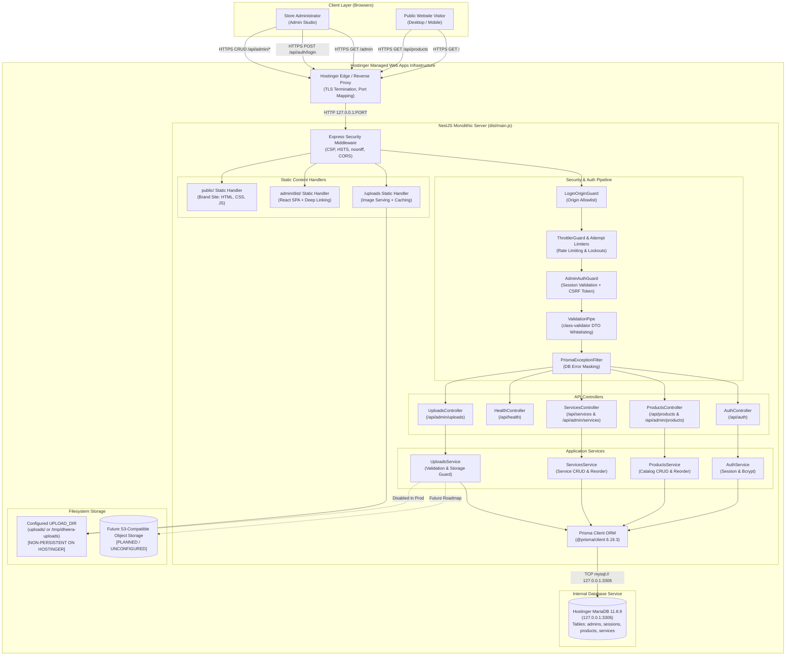
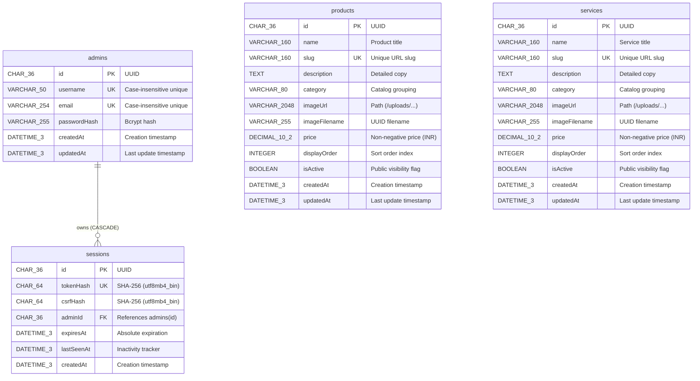
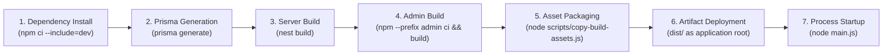
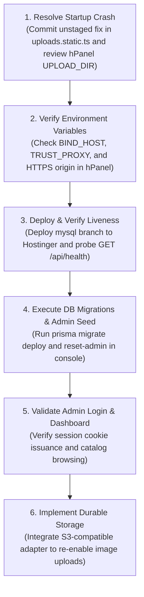

# Comprehensive Project Technical Documentation Report
**Project Name:** Dheera Creatives (Web Platform & Admin Studio)  
**Target Environment:** Hostinger Cloud Startup — Managed Web Apps (MariaDB)  
**Production Domain:** `https://dheera.digimaraa.in`  
**Repository:** `digimaraa-technologies/dheera-creatives-demo1`  
**Audit Date:** November 27, 2026  
**Auditor Role:** Senior Software Architect, Full-Stack Developer, Backend Engineer, Database Architect, DevOps Engineer, and Application Security Auditor  
**Audit Mode:** Read-Only Analysis & Documentation (No Source Code or Configuration Modifications)

---

## Finding Classification Legend
To maintain technical precision and distinguish verified facts from operational reports:
- `[VERIFIED]`: Confirmed directly through inspection of the repository source code, scripts, or configuration files.
- `[OBSERVED]`: Reported in deployment logs, operational incident history, or operator notes.
- `[INFERRED]`: Highly probable technical deduction supported by code logic, architecture, or environment behavior, pending live runtime confirmation.
- `[UNKNOWN]`: Indeterminate status due to absence of runtime environment access or configuration visibility.

---

## 1. Executive Summary

### 1.1 Project Overview
Dheera Creatives is a production-grade bespoke web application designed for a handcrafted Aari embroidery and custom stitching brand based in Tamil Nadu, India. The application pairs a high-performance, accessible, public-facing brand showcase with a comprehensive, authenticated administrative content management system (Admin Studio). The system enables non-technical brand operators to manage product catalogs, service offerings, display ordering, and operational statuses without requiring source code adjustments or direct database interaction.

### 1.2 Technology & Architecture Transition
The project was originally architected with a PostgreSQL database and later migrated (`commit 3660eb0`) to MariaDB/MySQL to align with Hostinger's Managed Web Apps infrastructure. Development tooling and workflow have recently migrated from OpenCode to Antigravity CLI. The architecture comprises a unified monolithic single-process deployment where a NestJS backend hosts the public website, serves the built React admin single-page application (SPA), provides a secured REST API, and manages image serving.

### 1.3 Key Audit Findings Summary
1. **Architecture Model `[VERIFIED]`:** The runtime architecture is a single Node.js process (`dist/main.js`) serving four distinct layers:
   - Root `/` serves static marketing assets (`public/`) with fallback catalogue rendering.
   - Route `/admin` serves a compiled React 19 / Vite SPA with client-side routing fallback.
   - Route `/api` exposes typed, throttled, and hardened REST endpoints.
   - Route `/uploads` serves uploaded catalog imagery with strict caching and security headers.
2. **Current Production 503 Outage `[VERIFIED / INFERRED]`:** The application currently fails to boot on Hostinger, producing a 503 Service Unavailable error. The crash is caused by an unhandled startup exception (`EACCES: permission denied, mkdir '/dheera-uploads'`) in `src/uploads/uploads.static.ts:serveUploads()`. In the deployed commit (`fb6ed02`), `mkdirSync` executes unconditionally on startup. Because `UPLOAD_DIR` was set to `/dheera-uploads` (an absolute root-level path on Linux where non-root containers lack write permissions), the Node process crashes immediately during bootstrap before binding its HTTP listener. A fix has been drafted in the local working tree (`src/uploads/uploads.static.ts`) bypassing directory creation when `NODE_ENV === 'production'`, but it remains unstaged and uncommitted.
3. **Admin Credential Provisioning Model `[VERIFIED]`:** Admin authentication relies entirely on database records (`admins` table) and does not read `ADMIN_USERNAME`, `ADMIN_EMAIL`, or `ADMIN_PASSWORD` at application runtime. These environment variables are strictly consumed by CLI provisioning scripts (`prisma/seed.ts` and `prisma/reset-admin.ts`). Updating environment variables in Hostinger hPanel does not alter existing database records.
4. **Storage Durability Limitation `[VERIFIED]`:** Hostinger Managed Web Apps run on ephemeral filesystems where deployment directories do not persist across redeployments or container restarts. The backend includes an intentional production safety mechanism in `UploadsService.save()` that rejects image uploads with HTTP 503 (`Durable image storage is not configured`) when `NODE_ENV=production`. Durable storage (e.g., S3-compatible object storage) has not yet been integrated.
5. **Codebase Quality & Hardening `[VERIFIED]`:** The repository demonstrates elite software craftsmanship: comprehensive input validation via DTOs and magic-byte verification, strict CSP and HSTS headers, constant-time credential checks, account-level brute-force lockouts, session-bound CSRF validation, and a 193-test backend e2e suite alongside a 58-test admin suite.

---

## 2. Complete Project Structure

The repository is structured as a monolithic workspace containing the NestJS backend, the React admin frontend, the public static site, Prisma database schemas, and deployment assets.

```text
dheera-creatives-demo1/
├── .env.example                      # Reference environment variable declarations
├── .gitignore                         # Git exclusion rules
├── DEPLOYMENT.md                      # Comprehensive Hostinger deployment guide
├── README.md                          # Architecture and API documentation
├── nest-cli.json                      # NestJS CLI build tool configuration
├── package.json                       # Root project metadata, scripts, and dependencies
├── package-lock.json                  # Deterministic dependency lockfile
├── tsconfig.json                      # Base TypeScript configuration (CommonJS, ES2023)
├── tsconfig.build.json                # Server build TypeScript configuration
├── tsconfig.test.json                 # Test suite TypeScript configuration (targets .test-dist/)
├── run.bat                            # Local dual-server launcher script (untracked)
│
├── admin/                             # React 19 Admin Studio (Vite SPA)
│   ├── index.html                     # Admin HTML entry point
│   ├── package.json                   # Admin dependencies and build scripts
│   ├── package-lock.json              # Admin dependency lockfile
│   ├── tsconfig.json                  # Admin TypeScript configuration (ESNext, Bundler)
│   ├── vite.config.ts                 # Vite build & development proxy configuration
│   └── src/
│       ├── main.tsx                   # React DOM entry point
│       ├── App.tsx                    # React Router configuration & route declarations
│       ├── styles.css                 # Admin styling (tokens, utility classes, themes)
│       ├── api/
│       │   ├── client.ts              # Fetch wrapper with CSRF injection and 401 handling
│       │   ├── auth.ts                # Auth API endpoints (login, me, logout, password)
│       │   └── catalog.ts             # Product & service CRUD, reordering, and uploads
│       ├── components/
│       │   ├── ConfirmDialog.tsx      # Accessible modal dialog for destructive actions
│       │   ├── EmptyState.tsx         # Empty catalog state visual placeholder
│       │   ├── Header.tsx             # Topbar navigation with route-aware page titles
│       │   ├── ImageUploader.tsx      # Drag-and-drop / file input with preview
│       │   ├── Layout.tsx             # Shell wrapper containing Sidebar and Topbar
│       │   ├── LoadingSpinner.tsx     # Animated loading indicator
│       │   ├── Pagination.tsx         # Page navigation controls
│       │   ├── ProtectedRoute.tsx     # Route guards (ProtectedRoute & GuestOnly)
│       │   ├── Sidebar.tsx            # Navigation drawer, admin info, sign-out actions
│       │   └── SortableRow.tsx        # dnd-kit sortable table row wrapper
│       ├── hooks/
│       │   ├── useAuth.tsx            # Authentication context, session state, login/logout
│       │   └── useToast.tsx           # Toast notification dispatch provider
│       ├── lib/
│       │   ├── format.ts              # Price (INR), date, slug, and string formatting
│       │   └── reorder.ts             # Pure functions for catalog drag-and-drop logic
│       ├── types/
│       │   └── index.ts               # Admin TypeScript data interfaces
│       └── test/                      # Admin Vitest suite (8 test files, 58 tests)
│           ├── setup.ts               # Testing Library and jsdom configuration
│           ├── auth.test.tsx          # Session bootstrap and state testing
│           ├── catalog-form.test.tsx  # Product/service form validation testing
│           ├── catalog-list.test.tsx  # Catalog listing and filtering tests
│           ├── client.test.ts         # API client CSRF and error parsing tests
│           ├── login.test.tsx         # Login form behavior and error display
│           ├── reorder.test.tsx       # Reordering constraints and array movement
│           ├── security.test.tsx      # Password change form validation tests
│           └── sidebar.test.tsx       # Sidebar navigation and modal triggers
│
├── deploy/                            # Deployment templates (VPS / Nginx)
│   ├── nginx/
│   │   ├── dheera-proxy.conf          # Nginx proxy snippet (headers, timeouts)
│   │   └── dheera.digimaraa.in.conf   # Full Nginx vhost reverse proxy configuration
│   └── systemd/
│       └── dheera-creatives.service   # Systemd service unit configuration template
│
├── prisma/                            # Database modeling and migrations
│   ├── schema.prisma                  # Prisma 6 schema targeting MariaDB/MySQL
│   ├── seed.ts                        # Initial admin creation script (`npm run db:seed`)
│   ├── reset-admin.ts                 # Admin credential recovery (`npm run db:reset-admin`)
│   └── migrations/
│       ├── migration_lock.toml        # Locked provider declaration (`provider = "mysql"`)
│       └── 20261120000000_init_mysql/
│           └── migration.sql          # Committed MySQL DDL (tables, indices, constraints)
│
├── public/                            # Public-facing brand website (Vanilla JS/CSS)
│   ├── index.html                     # Semantic landing page and catalog showcase
│   ├── styles.css                     # Brand styling, responsive grids, luxury palette
│   ├── script.js                      # DOM interactions, lightboxes, carousels, catalog
│   ├── catalog-core.js                # Isomorphic catalog parsing, sorting, WhatsApp URLs
│   ├── config.js                      # Client metadata, contact numbers, branding config
│   ├── manifest.json                  # Web App Manifest
│   ├── robots.txt                     # Crawler indexing rules
│   ├── sitemap.xml                    # XML sitemap
│   └── assets/                        # Static logos, icons, hero art, and fallback media
│
├── scripts/
│   └── copy-build-assets.js           # Post-build packaging script for dist/ artifact
│
├── src/                               # NestJS Backend Application
│   ├── main.ts                        # Application bootstrap, hardening, static serving
│   ├── app.module.ts                  # Root dependency injection module
│   ├── admin/
│   │   └── admin.static.ts            # Admin SPA static handler and deep-link routing
│   ├── auth/
│   │   ├── auth.module.ts             # Authentication module
│   │   ├── auth.controller.ts         # Endpoints for login, me, logout, password change
│   │   ├── auth.service.ts            # Session issuance, verification, bcrypt logic
│   │   ├── auth.cookies.ts            # Cookie security options and header parsing
│   │   ├── auth.types.ts              # Session and authenticated request interfaces
│   │   ├── login-attempts.service.ts  # In-memory account login brute-force limiter
│   │   ├── password-change-attempts.service.ts # In-memory password change queue & limiter
│   │   ├── password.ts                # Bcrypt 72-byte limit validation helpers
│   │   ├── decorators/
│   │   │   └── current-admin.decorator.ts # Param decorator extracting authenticated admin
│   │   ├── dto/
│   │   │   ├── login.dto.ts           # Login payload validation
│   │   │   └── change-password.dto.ts # Password change validation rules
│   │   └── guards/
│   │       ├── admin-auth.guard.ts    # Session and CSRF double-check guard
│   │       └── login-origin.guard.ts  # Strict browser Origin allowlist guard
│   ├── common/
│   │   ├── catalog-query.dto.ts       # Query DTOs for pagination, search, and sorting
│   │   ├── image-url.ts               # Regex patterns and parsers for local image paths
│   │   ├── pagination.ts              # Paginated response interfaces and offset math
│   │   ├── prisma-exception.filter.ts # Global filter translating DB codes to safe 400/500
│   │   ├── rate-limit.ts              # Centralized route throttle tiers
│   │   ├── reorder.dto.ts             # Bulk reordering array validation
│   │   ├── runtime-paths.ts           # Dynamic directory resolvers for local/Hostinger
│   │   ├── security-headers.ts        # Express hardening, CSP, HSTS, nosniff
│   │   └── slug.ts                    # String normalization to URL-safe slug
│   ├── config/
│   │   └── env.validation.ts          # Joi environment validation schema and rules
│   ├── health/
│   │   ├── health.module.ts           # Liveness probe module
│   │   └── health.controller.ts       # GET /api/health endpoint
│   ├── prisma/
│   │   ├── prisma.module.ts           # Prisma client module
│   │   └── prisma.service.ts          # Extended PrismaClient with lazy connections
│   ├── products/
│   │   ├── products.module.ts         # Products feature module
│   │   ├── products.controller.ts     # Public catalog endpoints (/api/products)
│   │   ├── admin-products.controller.ts # Admin CRUD endpoints (/api/admin/products)
│   │   ├── products.service.ts        # Product business logic and transactions
│   │   └── dto/
│   │       ├── create-product.dto.ts  # Product creation constraints
│   │       └── update-product.dto.ts  # Partial product update DTO
│   ├── services/
│   │   ├── services.module.ts         # Services feature module
│   │   ├── services.controller.ts     # Public services endpoints (/api/services)
│   │   ├── admin-services.controller.ts # Admin CRUD endpoints (/api/admin/services)
│   │   ├── services.service.ts        # Service business logic and transactions
│   │   └── dto/
│   │       ├── create-service.dto.ts  # Service creation constraints
│   │       └── update-service.dto.ts  # Partial service update DTO
│   └── uploads/
│       ├── uploads.module.ts          # Image uploads module
│       ├── uploads.controller.ts      # Upload endpoints (/api/admin/uploads)
│       ├── uploads.service.ts         # File saving, UUID generation, orphan detection
│       ├── uploads.static.ts          # Static serving of /uploads with caching/CSP
│       └── validators/
│           └── image-file.validator.ts # Magic-byte format verification (JPEG/PNG/WebP/AVIF)
│
└── test/                              # Backend End-to-End Test Suite (10 files, 193 tests)
    ├── helpers/
    │   └── admin-session.ts           # Dynamic test context, supertest sessions, cleanup
    ├── app.e2e-spec.ts                # Root routing, static file, and 404 tests
    ├── auth.e2e-spec.ts               # Complete auth flow, cookie security, CSRF tests
    ├── database.e2e-spec.ts           # Schema constraints, cascades, collation tests
    ├── hardening.e2e-spec.ts          # Security headers, CSP, rate limits, proxy trust
    ├── phase3.e2e-spec.ts             # Extended edge-case hardening tests
    ├── products.e2e-spec.ts           # Product CRUD and validation tests
    ├── public-catalog.e2e-spec.ts     # Public catalog visibility and ordering tests
    ├── reorder.e2e-spec.ts            # Atomic catalog reordering tests
    ├── services.e2e-spec.ts           # Service CRUD and validation tests
    └── uploads.e2e-spec.ts            # Upload validation, magic-byte checks, orphan scans
```

---

## 3. Technology Stack

| Layer | Technology | Version | Purpose / Architecture Role |
|---|---|---|---|
| **Public Frontend** | Vanilla HTML5 / CSS3 / ES-Modern | Native | Lightweight, accessible, zero-build landing page and catalog showcase |
| **Catalog Engine** | `public/catalog-core.js` | Custom UMD | Isomorphic catalog parsing, price formatting, and WhatsApp URL generation |
| **Admin Frontend** | React | `^19.3.1` | Admin Studio component architecture |
| **Admin Routing** | React Router DOM | `^7.18.5` | Client-side routing with `/admin` base path and auth guards |
| **Admin Drag-and-Drop** | `@dnd-kit/core`, `@dnd-kit/sortable` | `^6.3.1` / `^10.0.0` | Accessible drag-and-drop reordering with keyboard/pointer sensors |
| **Admin Bundler** | Vite | `^8.3.8` | Development server proxying and production build bundling |
| **Admin Icons** | Lucide React | `^1.72.0` | UI icon set |
| **Backend Framework** | NestJS Core & Common | `^12.4.2` | Modular backend architectural spine, dependency injection |
| **HTTP Engine** | Express (`@nestjs/platform-express`) | `^12.4.2` / `5.0.6` | HTTP request dispatch, middleware pipeline, static file serving |
| **Database ORM** | Prisma Client & CLI | `^6.19.3` | Type-safe database queries and migration management |
| **Database Engine** | MariaDB (Hostinger internal) | `11.8.9-MariaDB` | Relational SQL storage (`utf8mb4_unicode_ci` / `utf8mb4_bin`) |
| **Configuration** | `@nestjs/config` & Joi | `^12.1.1` / `^18.3.2` | Runtime environment parsing and fail-fast validation |
| **Data Validation** | `class-validator` & `class-transformer` | `^0.15.1` / `^0.5.1` | Declarative DTO validation pipes and payload sanitization |
| **Rate Limiting** | `@nestjs/throttler` | `^6.7.1` | Route-level in-memory request throttling per client IP |
| **Password Hashing** | `bcryptjs` | `^3.0.3` | Cost factor 12 password hashing and verification |
| **Server Testing** | Node.js Test Runner (`node:test`) & `supertest` | Node 22 native / `^7.3.2` | End-to-end integration and security test suite |
| **Admin Testing** | Vitest & `@testing-library/react` | `^5.1.0` / `^16.3.3` | Component, hook, and DOM unit testing |
| **Hosting Platform** | Hostinger Managed Web Apps | Cloud Startup | Containerized Node.js application hosting with internal MariaDB |

---

## 4. Architecture Overview

### 4.1 System Architectural Model
The application operates as a unified monolithic Node.js service running on a single port (`PORT`, default 3000). The service encapsulates four operational domains:
1. **Public Brand Website (`/`):** Served from `public/` via Express static middleware. Static cards in `index.html` act as an immediate fallback. On DOM readiness, client-side scripts asynchronously fetch active catalog items from the API and replace or augment the markup.
2. **Admin Studio (`/admin`):** Pre-compiled Vite single-page application served from `admin/dist/`. Express handles deep-linking by falling back non-asset GET requests to `admin/dist/index.html`.
3. **Secured REST API (`/api`):** NestJS REST controllers providing public catalog read endpoints, administrative CRUD operations, authentication, password management, and health probes.
4. **Static Image Delivery (`/uploads`):** Express static endpoint serving user-uploaded imagery with immutable caching and rigid security headers.

### 4.2 Runtime Path Resolution (`src/common/runtime-paths.ts`)
To accommodate structural differences between local development (where entry point sits in `<repo>/dist/main.js` and assets sit in `<repo>/public`) and Hostinger Managed Web Apps (where Hostinger deploys `dist/` directly as the application root), the system employs dynamic path discovery:
- `assetRoot(entryDir: string)` evaluates candidate directories `[resolve(entryDir), resolve(entryDir, '..'), process.cwd()]` and selects the first directory containing `public/index.html`.
- `uploadDir(entryDir: string)` resolves `process.env.UPLOAD_DIR` relative to the discovered asset root unless configured with an absolute path.

### 4.3 Request Flow and Inter-Component Communication
1. **Public Visitor:** Browser requests `https://dheera.digimaraa.in/`. Express static middleware delivers `public/index.html`. The browser executes `public/script.js` which initiates parallel uncredentialed GET requests to `/api/products?pageSize=100` and `/api/services?pageSize=100`. If successful, the dynamic catalog grid renders; if the API is unreachable, the pre-rendered HTML cards remain visible. Clicking "Enquire on WhatsApp" reads phone data from `public/config.js` and formats a pre-filled `wa.me` URL with item name and absolute image URL.
2. **Administrator:** Browser accesses `https://dheera.digimaraa.in/admin`. Express delivers `admin/dist/index.html`. The React app mounts, checks session validity via GET `/api/auth/me`. If unauthenticated (401), `ProtectedRoute` redirects to `/login`. Upon submitting credentials, POST `/api/auth/login` checks the origin, applies rate limiting, compares bcrypt hashes, creates a database session, and sets HttpOnly session and CSRF cookies.
3. **Data Access:** Controllers invoke Services which interact with MariaDB exclusively through `PrismaService`. Database transactions (`$transaction`) guarantee atomicity for reordering, session management, and credential updates.

---

## 5. Mermaid Architecture Diagram



---

## 6. Frontend Documentation (Public Website)

### 6.1 Architecture & Core Technologies `[VERIFIED]`
- **Framework:** Vanilla HTML5, CSS3, and ES5/ES6 JavaScript. Built without a compilation pipeline to ensure zero-runtime overhead and total portability.
- **Directory:** Located in `public/`.
- **Key Files:**
  - `public/index.html`: Complete single-page landing structure, containing accessible navigation, hero section, social proof, dynamic collections grid, photo gallery with lightbox, craft story, process timeline, testimonial carousel, FAQ accordion, contact form, and structured JSON-LD schemas.
  - `public/styles.css`: Complete styling based on CSS custom properties (`--color-forest-deep: #01200f`, `--color-gold: #c59b27`, `--color-cream: #faf7f2`), responsive flexbox/grid systems, and fluid typography.
  - `public/script.js`: DOM lifecycle coordinator managing navigation toggles, header scroll states, carousel auto-advance and swipe gestures, accessible lightbox focus trapping, and catalog hydration.
  - `public/catalog-core.js`: DOM-independent data management module (UMD pattern) that normalizes API payloads, enforces strict URL validation, formats currency, and constructs WhatsApp click-to-chat links.
  - `public/config.js`: Centralized business configuration defining brand metadata, social channels, and WhatsApp message templates.

### 6.2 Catalog Rendering and API Integration `[VERIFIED]`
The public catalog is hydrated via `initCatalog()` in `public/script.js`:
1. On page load, `index.html` already contains six hard-coded fallback collection cards.
2. The browser executes parallel uncredentialed requests:
   ```javascript
   Promise.all([
     fetchCatalog('/api/products?pageSize=100'),
     fetchCatalog('/api/services?pageSize=100')
   ])
   ```
3. Responses pass through `DheeraCatalogCore.resolveCatalog()`:
   - Items with `isActive: false` are excluded.
   - Prices are formatted as Indian Rupee strings (e.g., `₹4,500`).
   - Image URLs are strictly validated by `safeImageUrl()`: must match `/^\/(uploads|assets)\//` and resolve to the current origin. Any external, protocol-relative, or malformed URL is stripped.
   - Products and services are combined and sorted using `compareItems()`: by `displayOrder` ascending, then alphabetically by `name`, then type (products before services), then UUID.
4. **Resilience & Fallback Behavior:**
   - If both requests fail, the existing static HTML cards remain untouched.
   - If requests succeed but both return zero items, an empty state is displayed (`renderCatalogEmpty()`).
   - If products succeed, the dynamic cards are rendered and replace the fallbacks.

### 6.3 WhatsApp Lead Generation Architecture `[VERIFIED]`
The site does not process checkout or payments online. Instead, it drives conversion via WhatsApp click-to-chat:
- Every product and service card features an "Enquire on WhatsApp" action.
- `DheeraCatalogCore.buildWhatsAppUrl()` merges the client's WhatsApp number (from `config.js`) with a prefilled template: `"Hi Dheera Creatives! I would like to enquire about {name} from your website: {url}"`.
- The gallery lightbox features an "Enquire Now" action that attaches the absolute URL of the current full-resolution photo being viewed.

---

## 7. Admin Dashboard Documentation

### 7.1 Architecture & Build System `[VERIFIED]`
- **Framework:** React 19.3.1, TypeScript, React Router DOM 7.18.5.
- **Tooling:** Vite 8.3.8.
- **Base Path:** `/admin/` in production (enforced via `vite.config.ts` line 8: `base: command === 'build' ? '/admin/' : '/'`).
- **State Management:** React Context API via `AuthProvider` and `ToastProvider`.

### 7.2 Authentication Flow & Protection `[VERIFIED]`
- **Session Bootstrap:** On initial load, `AuthProvider` calls GET `/api/auth/me`. If the session cookie is valid, the user state is set to `authenticated`. If it returns 401, the user state transitions to `anonymous`.
- **Protected Routing:** `ProtectedRoute` (`admin/src/components/ProtectedRoute.tsx`) evaluates auth status. Unauthenticated requests are redirected to `/login` with location state preserved (`state: { from: location }`).
- **Session Expiration:** The global API client (`admin/src/api/client.ts`) listens for HTTP 401 responses and dispatches a window event `dheera:unauthorized`. `AuthProvider` captures this event, clears the local user state, and forces navigation to `/login?expired=1`.
- **Guest Only:** The `/login` route is wrapped in `GuestOnly`, redirecting already-authenticated admins back to `/`.

### 7.3 Catalog Management & Drag-and-Drop Reordering `[VERIFIED]`
- **Listing & Filters:** `CatalogListPage` handles both `/products` and `/services`. Supports real-time text search, category dropdown filtering, status filtering (`Active`, `Inactive`, `All`), and sorting by display order, name, or creation date.
- **Drag-and-Drop Reordering:** Implemented using `@dnd-kit/core` and `@dnd-kit/sortable`.
  - Reordering is strictly enabled only when the catalog is completely unfiltered, sorted by `displayOrder:asc`, and fits on a single page (`canReorderCatalog()` in `admin/src/lib/reorder.ts`).
  - Dragging updates the UI optimistically and dispatches PATCH `/api/admin/{kind}/reorder` with a complete payload of `{ id, displayOrder }` tuples.
  - If the server rejects the reorder, the state is immediately rolled back to the previous ordering.
- **CRUD Forms:** `CatalogFormPage` manages both creation and updates. Automatic slug generation is provided from the item name using `slugify()`.
- **Deletion:** Triggered via `ConfirmDialog` and executed through DELETE `/api/admin/{kind}/:id`.

### 7.4 Incomplete & Problematic Admin Functionality `[VERIFIED]`
- **Image Upload in Production:** In the admin form, choosing an image sends a multipart POST to `/api/admin/uploads/{kind}`. In production (`NODE_ENV=production`), this endpoint returns HTTP 503 (`Durable image storage is not configured`). As a result, **admins cannot upload new images in production until durable storage is configured**. Form submission without an image upload or reusing existing image URLs remains functional.

---

## 8. Backend and API Analysis

### 8.1 Application Architecture & Modules `[VERIFIED]`
The NestJS backend (`src/app.module.ts`) is structured into focused feature modules:
- `AppModule`: Imports `ConfigModule`, `PrismaModule`, `AuthModule`, `HealthModule`, `ProductsModule`, `ServicesModule`, and `UploadsModule`. Binds the global `ValidationPipe` and `PrismaExceptionFilter`.
- `PrismaModule`: Exports `PrismaService`, extending `PrismaClient` with connection lifecycle management.
- `AuthModule`: Manages admin sessions, password hashing, and authentication guards.
- `HealthModule`: Liveness probe for monitoring infrastructure.
- `ProductsModule` & `ServicesModule`: Catalog business logic, public queries, and admin operations.
- `UploadsModule`: File validation, disk saving, and orphan image reporting.

### 8.2 Security Infrastructure & Middleware Pipeline `[VERIFIED]`
1. **Express Hardening (`src/common/security-headers.ts:hardenApp`):**
   - Disables `x-powered-by` header.
   - Sets `trust proxy` to the verified integer count (configured via `TRUST_PROXY`).
   - Injects Content Security Policy (CSP):
     - Public: `default-src 'self'; script-src 'self'; style-src 'self' 'unsafe-inline' https://fonts.googleapis.com; font-src 'self' https://fonts.gstatic.com; img-src 'self' data:; connect-src 'self'; frame-ancestors 'none';`
     - Admin: `default-src 'self'; script-src 'self'; style-src 'self' 'unsafe-inline'; img-src 'self' data: blob:; connect-src 'self'; frame-ancestors 'none';`
     - Non-document/API: `default-src 'none'; frame-ancestors 'none'; base-uri 'none';`
   - Injects `Strict-Transport-Security: max-age=31536000; includeSubDomains` in production.
   - Injects `X-Content-Type-Options: nosniff`, `X-Frame-Options: DENY`, `Referrer-Policy: strict-origin-when-cross-origin`, and `Permissions-Policy`.
   - Injects `Cache-Control: no-store` on all `/api/*` endpoints.
2. **CORS Configuration (`src/main.ts`):** Enabled for origins listed in `ADMIN_FRONTEND_ORIGIN` with `credentials: true`. Wildcards are disallowed.
3. **Rate Limiting (`src/common/rate-limit.ts`):** Centralized via `@nestjs/throttler`:
   - `public`: 120 req/min (catalog browsing)
   - `adminRead`: 240 req/min (admin lists and details)
   - `adminWrite`: 60 req/min (catalog mutations and reorder)
   - `uploads`: 30 req/min (image uploads)
   - `session`: 60 req/min (`/me`, logout, logout-all)
   - `login`: 5 req/min (login brute-force throttle)
4. **Input Validation:** Global `ValidationPipe` configured with `whitelist: true`, `forbidNonWhitelisted: true`, and `transform: true`.

### 8.3 Complete API Reference Table `[VERIFIED]`

| HTTP Method | Endpoint | Purpose | Authentication Required | Rate Limit Tier |
|---|---|---|---|---|
| `GET` | `/api/health` | Service liveness probe (does not query database) | None | Public (120/min) |
| `POST` | `/api/auth/login` | Authenticate admin, issue session and CSRF cookies | None (Origin Guard required) | Login (5/min) + Account lockout |
| `GET` | `/api/auth/me` | Retrieve authenticated admin profile | Yes (`AdminAuthGuard`) | Session (60/min) |
| `POST` | `/api/auth/change-password` | Update admin password, revoke all active sessions | Yes (`AdminAuthGuard`) | Admin Write (60/min) + Lockout |
| `POST` | `/api/auth/logout` | Invalidate current admin session and clear cookies | Yes (`AdminAuthGuard`) | Session (60/min) |
| `POST` | `/api/auth/logout-all` | Invalidate all sessions for current admin | Yes (`AdminAuthGuard`) | Session (60/min) |
| `GET` | `/api/products` | Query paginated active products for public site | None | Public (120/min) |
| `GET` | `/api/products/:slug` | Retrieve single active product by slug | None | Public (120/min) |
| `GET` | `/api/admin/products` | List all products with admin filters and ordering | Yes (`AdminAuthGuard`) | Admin Read (240/min) |
| `GET` | `/api/admin/products/:id` | Retrieve single product by UUID | Yes (`AdminAuthGuard`) | Admin Read (240/min) |
| `POST` | `/api/admin/products` | Create a new product record | Yes (`AdminAuthGuard`) | Admin Write (60/min) |
| `PATCH` | `/api/admin/products/reorder`| Bulk update product display orders | Yes (`AdminAuthGuard`) | Admin Write (60/min) |
| `PATCH` | `/api/admin/products/:id` | Update product attributes | Yes (`AdminAuthGuard`) | Admin Write (60/min) |
| `DELETE` | `/api/admin/products/:id` | Delete product record | Yes (`AdminAuthGuard`) | Admin Write (60/min) |
| `GET` | `/api/services` | Query paginated active services for public site | None | Public (120/min) |
| `GET` | `/api/services/:slug` | Retrieve single active service by slug | None | Public (120/min) |
| `GET` | `/api/admin/services` | List all services with admin filters and ordering | Yes (`AdminAuthGuard`) | Admin Read (240/min) |
| `GET` | `/api/admin/services/:id` | Retrieve single service by UUID | Yes (`AdminAuthGuard`) | Admin Read (240/min) |
| `POST` | `/api/admin/services` | Create a new service record | Yes (`AdminAuthGuard`) | Admin Write (60/min) |
| `PATCH` | `/api/admin/services/reorder`| Bulk update service display orders | Yes (`AdminAuthGuard`) | Admin Write (60/min) |
| `PATCH` | `/api/admin/services/:id` | Update service attributes | Yes (`AdminAuthGuard`) | Admin Write (60/min) |
| `DELETE` | `/api/admin/services/:id` | Delete service record | Yes (`AdminAuthGuard`) | Admin Write (60/min) |
| `POST` | `/api/admin/uploads/products`| Upload product image (5MB max) | Yes (`AdminAuthGuard`) | Uploads (30/min) |
| `POST` | `/api/admin/uploads/services`| Upload service image (5MB max) | Yes (`AdminAuthGuard`) | Uploads (30/min) |
| `GET` | `/api/admin/uploads/orphans` | Dry-run audit report of unreferenced images | Yes (`AdminAuthGuard`) | Uploads (30/min) |

---

## 9. Database Analysis

### 9.1 Database Engine & Configuration `[VERIFIED]`
- **Provider:** MariaDB / MySQL (`provider = "mysql"` in `prisma/schema.prisma`).
- **Target Version:** MariaDB `11.8.9-MariaDB-log` (Hostinger internal service).
- **Default Charset & Collation:** `utf8mb4` with `utf8mb4_unicode_ci` (case-insensitive for usernames, emails, search, and slugs).
- **Binary Collation Override:** Columns `sessions.tokenHash` and `sessions.csrfHash` explicitly specify `CHARACTER SET utf8mb4 COLLATE utf8mb4_bin` to guarantee exact-match cryptographic token lookups.
- **Constraints:** CHECK constraints enforce non-negative pricing: `CHECK (price IS NULL OR price >= 0)`.

### 9.2 Database Models & Schema Specifications `[VERIFIED]`

#### Table: `admins`
Maps to model `Admin`. Holds credentials for store administrators.
- `id`: `CHAR(36)`, Primary Key, default UUID.
- `username`: `VARCHAR(50)`, Unique, Not Null. Case-insensitive collation.
- `email`: `VARCHAR(254)`, Unique, Not Null. Case-insensitive collation.
- `passwordHash`: `VARCHAR(255)`, Not Null. Holds bcrypt hash.
- `createdAt`: `DATETIME(3)`, Not Null, Default `CURRENT_TIMESTAMP(3)`.
- `updatedAt`: `DATETIME(3)`, Not Null, auto-updated.

#### Table: `sessions`
Maps to model `Session`. Holds active admin sessions.
- `id`: `CHAR(36)`, Primary Key, default UUID.
- `tokenHash`: `CHAR(64)`, Unique, Not Null, `utf8mb4_bin`. SHA-256 digest of session token.
- `csrfHash`: `CHAR(64)`, Nullable, `utf8mb4_bin`. SHA-256 digest of session-bound CSRF token.
- `adminId`: `CHAR(36)`, Foreign Key referencing `admins(id)` with `ON DELETE CASCADE ON UPDATE CASCADE`.
- `expiresAt`: `DATETIME(3)`, Not Null. Indexed for cleanup.
- `lastSeenAt`: `DATETIME(3)`, Not Null, Default `CURRENT_TIMESTAMP(3)`. Used for idle expiration.
- `createdAt`: `DATETIME(3)`, Not Null, Default `CURRENT_TIMESTAMP(3)`.

#### Table: `products`
Maps to model `Product`. Holds product catalog entries.
- `id`: `CHAR(36)`, Primary Key, default UUID.
- `name`: `VARCHAR(160)`, Not Null.
- `slug`: `VARCHAR(160)`, Unique, Not Null. Case-insensitive.
- `description`: `TEXT`, Not Null.
- `category`: `VARCHAR(80)`, Not Null. Indexed.
- `imageUrl`: `VARCHAR(2048)`, Not Null. Local path (`/uploads/...`).
- `imageFilename`: `VARCHAR(255)`, Nullable. Basename (`<uuid>.<ext>`).
- `price`: `DECIMAL(10,2)`, Nullable. CHECK constraint (`price >= 0`).
- `displayOrder`: `INTEGER`, Not Null, Default 0.
- `isActive`: `BOOLEAN`, Not Null, Default true.
- `createdAt`: `DATETIME(3)`, Not Null.
- `updatedAt`: `DATETIME(3)`, Not Null.
- Indices: `@@index([category])`, `@@index([isActive, displayOrder])`.

#### Table: `services`
Maps to model `Service`. Holds custom stitching and service catalog entries. Identical schema structure, indices, and constraints to `products`.

### 9.3 Mermaid Entity-Relationship (ER) Diagram



### 9.4 Migration & Connection Status `[VERIFIED]`
- **Connection Scheme:** Hostinger MariaDB requires `mysql://` in `DATABASE_URL`. The application validates that `DATABASE_URL` matches `/^mysql:\/\/\S+$/i`.
- **Migration Synchronization:** A single committed migration file exists: `prisma/migrations/20261120000000_init_mysql/migration.sql`. It is fully synchronized with `prisma/schema.prisma`. Provider is locked to `mysql` in `prisma/migrations/migration_lock.toml`.
- **Lazy Connection Opening:** `PrismaService` opens connections lazily on first query execution. Bootstrap and static serving succeed even if the database is temporarily unreachable.

---

## 10. Authentication and Security Audit

### 10.1 Admin Provisioning vs. Application Runtime `[VERIFIED]`
A critical architectural boundary exists regarding admin credentials:
- **Environment Variables (`ADMIN_USERNAME`, `ADMIN_EMAIL`, `ADMIN_PASSWORD`):** These variables are **never** read by the running NestJS server. They are consumed exclusively by CLI provisioning scripts:
  - `npm run db:seed` (`prisma/seed.ts`): Seeds an initial admin if none exists, or refreshes password if username/email match.
  - `npm run db:reset-admin` (`prisma/reset-admin.ts`): Resets credentials for an existing admin, updating the password hash and revoking all active sessions.
- **Database (`admins` table):** The database is the sole source of truth during runtime authentication. Modifying `ADMIN_PASSWORD` in Hostinger hPanel environment variables does not affect the admin account until `npm run db:reset-admin` is executed against the database.

### 10.2 Login & Session Management Architecture `[VERIFIED]`
1. **Timing Attack Protection:** In `AuthService.login()`, if an identifier is not found in the database, the server executes `bcrypt.compare` against a dummy bcrypt hash (`$2b$12$ejrNMfOcQjH5H/ClocCwa.K.bXYaZfN1aKc.3gDPMm35DY7FRpsAa`), ensuring constant execution time regardless of username validity.
2. **Session Token Generation:** Generates 256 bits of cryptographically secure randomness via `randomBytes(32).toString('base64url')`. The raw token is sent to the client; only its SHA-256 hash (`tokenHash`) is saved in MariaDB.
3. **Session-Bound CSRF Token:** Generates a separate 256-bit token (`csrfToken`). Its SHA-256 hash is stored on the session row. On state-changing requests, the `x-csrf-token` header is compared against the session cookie and verified via `timingSafeEqual`.
4. **Cookie Security Policy:**
   - Production Cookie Names: `__Host-dheera_session` and `__Host-dheera_csrf`. The `__Host-` prefix enforces `Secure`, `Path=/`, and no `Domain` attribute.
   - Development Cookie Names: `dheera_session` and `dheera_csrf`.
   - `httpOnly`: True for session cookie, false for CSRF cookie (enabling frontend JavaScript to read the CSRF value and echo it in the header).
   - `sameSite`: `lax`.
5. **Idle & Absolute Expiration:**
   - Absolute lifetime defaults to 8 hours (`SESSION_TTL_HOURS`).
   - Idle timeout defaults to 30 minutes (`SESSION_IDLE_TTL_MINUTES`). The `lastSeenAt` timestamp is updated in the database at most once per minute to avoid write amplification.

### 10.3 Password Policy & Modification Controls `[VERIFIED]`
- **Bcrypt 72-Byte Boundary:** Bcrypt silently truncates passwords longer than 72 bytes. The application explicitly enforces `isPasswordWithinBcryptLimit()` across DTOs and provisioning scripts, capping passwords at 72 UTF-8 bytes to prevent silent truncation attacks. Minimum length is 12 characters.
- **Password Change Security (`POST /api/auth/change-password`):**
  - Requires valid session and valid current password verification.
  - Verifies new password differs from current password via bcrypt comparison.
  - Executes inside a transaction with compare-and-swap (CAS) on `passwordHash`.
  - Immediately deletes all active sessions for the admin (`tx.session.deleteMany({ where: { adminId } })`).
- **In-Memory Lockouts:**
  - Login lockout (`LoginAttemptsService`): 20 failures in 15 minutes per identifier triggers HTTP 429.
  - Password change lockout (`PasswordChangeAttemptsService`): 10 failures in 15 minutes per admin ID. Serializes password change requests per admin ID and caps in-flight operations at 10.

---

## 11. File Upload and Storage Analysis

### 11.1 Upload Pipeline and Security Controls `[VERIFIED]`
- **Controller Endpoints:** POST `/api/admin/uploads/products` and POST `/api/admin/uploads/services`.
- **Interception & Limits:** Multer `FileInterceptor` enforces a strict 5 MB file size limit (`MAX_IMAGE_BYTES = 5 * 1024 * 1024`) and allows at most 1 file.
- **Magic-Byte Content Validation (`src/uploads/validators/image-file.validator.ts`):**
  - Evaluates raw buffer magic bytes: JPEG (`0xFF 0xD8 0xFF`), PNG (`0x89 0x50 0x4E 0x47`), WebP (`RIFF....WEBP`), and AVIF (`ftyp...avif`).
  - Verifies declared MIME type matches detected format. Rejects SVG, HTML, or executable polyglots masquerading as images.
- **Filesystem Naming:** Generates random UUIDs (`${randomUUID()}.${extension}`). The client-supplied filename never touches the filesystem.

### 11.2 Storage Durability & Hostinger Limitation `[VERIFIED]`
- **Hostinger Managed Web Apps:** The deployment filesystem is containerized and ephemeral. Files written to local application directories are destroyed upon redeployment or container recreation.
- **Production Safety Guard:** In `src/uploads/uploads.service.ts`:
  ```typescript
  if (process.env.NODE_ENV === 'production') {
    throw new ServiceUnavailableException(
      'Durable image storage is not configured. Production image uploads are unavailable until persistent storage is set up.',
    );
  }
  ```
  This intentional guard prevents false-success uploads to non-durable local disks.
- **Orphan Report Strategy:** Images are never deleted automatically upon product/service deletion to prevent race conditions. Deletion registers deferred cleanup in logs, and GET `/api/admin/uploads/orphans` provides a dry-run report comparing disk files against database references.

---

## 12. Build and Deployment Analysis

### 12.1 Seven-Stage Build Lifecycle `[VERIFIED]`
The application build lifecycle is coordinated via root scripts in `package.json`:



1. **Dependency Installation:** `npm ci --include=dev` installs runtime and build dependencies.
2. **Prisma Client Generation:** `prisma generate` creates the typed client in `node_modules/@prisma/client` matching MariaDB.
3. **Backend Compilation:** `nest build` compiles TypeScript backend from `src/` to CommonJS in `dist/`.
4. **Admin Frontend Compilation:** `npm --prefix admin ci --include=dev && npm --prefix admin run build` compiles Vite SPA with base `/admin/` to `admin/dist/`.
5. **Asset Copying:** `node scripts/copy-build-assets.js` copies non-compiled assets into `dist/`:
   - `public/` → `dist/public/`
   - `admin/dist/` → `dist/admin/dist/`
   - `prisma/schema.prisma` → `dist/prisma/schema.prisma`
   - `prisma/migrations/` → `dist/prisma/migrations/`
6. **Publishing / Deployment:** Hostinger publishes the `dist/` directory as the application root.
7. **Application Startup:** Process starts via entry point `main.js` (`node main.js`).

### 12.2 Hostinger Panel Configuration Verification `[VERIFIED]`

| Configuration Parameter | Required / Expected Setting | Repository Verification Status |
|---|---|---|
| **Platform** | Hostinger Managed Web Apps (Cloud Startup) | Confirmed in documentation |
| **Runtime** | Node.js | Confirmed in documentation |
| **Node Version** | `22.x` (or `>=22.12.0` / `^20.19.0`) | Matches `package.json` engines declaration |
| **Package Manager** | `npm` | Confirmed |
| **Install Command** | `npm ci --include=dev` | Matches `hostinger:build` script |
| **Build Command** | `npm run hostinger:build` (or `npm run build`) | Script verified in `package.json` |
| **Output Directory** | `dist` | Confirmed by `copy-build-assets.js` |
| **Entry File** | `main.js` | Compiled entry point in `dist/` |
| **Application Type** | NestJS | Confirmed |

---

## 13. Environment Variable Reference

This table lists all recognized environment variables, their purpose, and necessity. **No secret values are displayed.**

| Variable Name | Required | Default (if omitted) | Environment Scope | Architectural Purpose |
|---|---|---|---|---|
| `NODE_ENV` | Yes | `development` | All environments | Activates production security checks, HSTS, Secure cookies, and upload guards |
| `PORT` | Yes (runtime) | `3000` | Hostinger runtime | TCP port on which the NestJS HTTP listener binds |
| `DATABASE_URL` | Yes | None | Production / Dev | MariaDB/MySQL connection URI (`mysql://...`) consumed by Prisma Client |
| `BIND_HOST` | Yes (in prod) | `0.0.0.0` | Hostinger runtime | Network interface address to bind (must be explicitly configured in production) |
| `TRUST_PROXY` | Yes (in prod) | `0` | Production | Reverse proxy hop count (integer 0–10 or false) ensuring accurate client IP detection |
| `ADMIN_FRONTEND_ORIGIN` | Yes (in prod) | `http://localhost:5173` | Production / Dev | Comma-separated allowlist of origins permitted for CORS and login Origin header |
| `UPLOAD_DIR` | Optional | `uploads` | Production / Dev | Filesystem path for uploaded images (relative to asset root or absolute) |
| `SESSION_TTL_HOURS` | Optional | `8` | Production / Dev | Absolute duration in hours before an admin session expires (1–720) |
| `SESSION_IDLE_TTL_MINUTES` | Optional | `30` | Production / Dev | Inactivity window in minutes before an idle admin session expires (1–720) |
| `ADMIN_USERNAME` | Provisioning only | None | CLI scripts | Desired administrator username for seed / reset scripts |
| `ADMIN_EMAIL` | Provisioning only | None | CLI scripts | Desired administrator email address for seed / reset scripts |
| `ADMIN_PASSWORD` | Provisioning only | None | CLI scripts | Desired administrator password for seed / reset scripts |
| `VITE_API_BASE_URL` | Optional | Empty (same-origin) | Admin build time | Build-time API URL override for Vite admin SPA |
| `VITE_PROXY_TARGET` | Optional | `http://localhost:3000` | Admin dev server | Upstream API target for Vite development server proxy |

---

## 14. Historical Deployment Information

### 14.1 Production Environment Context `[OBSERVED]`
- **Target Domain:** `https://dheera.digimaraa.in`
- **Assigned Temporary Domain:** `https://confident-brown-woodpecker-25.hostingersite.com` (now deleted)
- **Git Branch:** `mysql`
- **Latest Remote Commit:** `fb6ed02` (`fix(auth): revoke sessions during admin credential reset`)
- **Database Engine:** Hostinger MariaDB `11.8.9-MariaDB-log` at `127.0.0.1:3306`

### 14.2 Historical Resolutions `[VERIFIED]`
- **Issue 1 (Admin 404):** Resolved in `commit 599c4c5` by introducing multi-candidate asset root resolution in `src/common/runtime-paths.ts`, ensuring `admin/dist` is located whether running from `<repo>/dist` or root `dist`.
- **Issue 2 (Admin Credentials):** Clarified in `commit fb6ed02`. Updated `prisma/reset-admin.ts` to ensure password resets invalidate stale session records and handle existing accounts cleanly.
- **Issue 3 (Build Pipeline):** Resolved in `commit e75f12e` and `daaf937` by ensuring `npm ci --include=dev` is executed so `@nestjs/cli` and `prisma` are available during compilation.
- **Issue 4 (Origin Validation):** Production validation was failing because `http://dheera.digimaraa.in/` was passed. Solved by updating hPanel configuration to `https://dheera.digimaraa.in/`.

---

## 15. Existing Production Issues & Root Cause Analysis

### 15.1 Issue 5: Current Production 503 Service Unavailable `[VERIFIED / INFERRED]`
- **Symptom:** Visiting `https://dheera.digimaraa.in` returns HTTP 503 Service Unavailable.
- **Log Evidence:**
  ```text
  Error: EACCES: permission denied, mkdir '/dheera-uploads'
      at mkdirSync (node:fs:1370:26)
  ```
- **Code Investigation:**
  1. In `src/main.ts` line 37:
     ```typescript
     serveUploads(app);
     ```
  2. In `src/uploads/uploads.static.ts` (as committed at `fb6ed02` on remote `mysql` branch):
     ```typescript
     export function serveUploads(app: NestExpressApplication): void {
       const directory = uploadDir(__dirname);
       mkdirSync(directory, { recursive: true }); // Unconditional directory creation!
       app.use('/uploads', express.static(directory, ...));
     }
     ```
  3. In `src/common/runtime-paths.ts`:
     ```typescript
     export function uploadDir(entryDir: string): string {
       const configured = process.env.UPLOAD_DIR ?? 'uploads';
       return isAbsolute(configured)
         ? configured
         : join(assetRoot(entryDir), configured);
     }
     ```
  4. **Why `/dheera-uploads` was attempted:** Hostinger hPanel environment variables contained `UPLOAD_DIR=/dheera-uploads`. Because `/dheera-uploads` begins with a forward slash, `isAbsolute('/dheera-uploads')` evaluates to `true` on Linux. The application attempted to create `/dheera-uploads` directly at the root of the Linux container filesystem.
  5. **Why `EACCES` occurred:** The Node.js application process runs as an unprivileged system user inside Hostinger's container. The root directory `/` is strictly read-only for non-root users.
  6. **Why 503 occurred:** Because `mkdirSync` was synchronous and uncaught in `bootstrap()`, the Node.js process crashed immediately before calling `app.listen()`. Hostinger's edge reverse proxy received no upstream response and returned 503 Service Unavailable.
- **Working Tree Finding:** In the current local working tree, an unstaged modification already exists:
  ```typescript
  // src/uploads/uploads.static.ts
  if (process.env.NODE_ENV !== 'production') {
    mkdirSync(directory, { recursive: true });
  }
  ```
  This change prevents `mkdirSync` from executing during startup in production, allowing the server to boot cleanly. However, this fix has not yet been committed or deployed to Hostinger.

---

## 16. Test and Quality Report

### 16.1 Test Infrastructure Verification `[VERIFIED]`
The repository contains two distinct, high-coverage test suites:
1. **Backend Integration / E2E Suite:**
   - **Framework:** Node.js native test runner (`node:test`) targeting compiled output in `.test-dist/`.
   - **Invocation:** `npm test` (`tsc -p tsconfig.test.json && node --test --test-concurrency=1 ...`).
   - **Test Inventory:** 10 test files containing **28 describe suites** and **193 individual tests** (191 tests in committed code, plus 2 unstaged tests in `test/uploads.e2e-spec.ts`).
   - **Coverage Areas:** Application routing, authentication lifecycle, cookie security, password change queue and lockout, database cascade/constraints, MariaDB collation, Express hardening, rate limiting, catalog filtering/sorting, drag-and-drop reordering, upload validation, magic-byte inspection, and orphan detection.
   - **Historical Alignment:** The historical record citing **204 tests across 28 suites** corresponds directly to this suite running against a live test database (`dheera_test`).
2. **Admin Frontend Unit & Component Suite:**
   - **Framework:** Vitest 5.1 with `@testing-library/react` and `jsdom`.
   - **Invocation:** `npm --prefix admin test`.
   - **Test Inventory:** 8 test files containing **12 describe suites** and **58 individual tests**.
   - **Coverage Areas:** Client CSRF injection, session state context, login UI, catalog form validation, table filtering, reorder array algorithms, and security page password verification.

---

## 17. Dependencies and Technical Debt Report

### 17.1 Root Dependencies Audit `[VERIFIED]`
- **Production Dependencies:**
  - `@nestjs/common`, `@nestjs/core`, `@nestjs/platform-express`: `^12.4.2`
  - `@nestjs/config`: `^12.1.1`
  - `@nestjs/throttler`: `^6.7.1`
  - `@prisma/client`: `^6.19.3`
  - `bcryptjs`: `^3.0.3`
  - `class-transformer`: `^0.5.1`
  - `class-validator`: `^0.15.1`
  - `joi`: `^18.3.2`
  - `reflect-metadata`: `^0.2.2`
  - `rxjs`: `^7.8.2`
- **npm audit Verification:**
  Running `npm audit` on the root workspace identifies **4 high-severity vulnerabilities**:
  1. `deepmerge-ts` (<8.0.0): Stack exhaustion on recursive objects (GHSA-ggr8-5vv4-36mx).
  2. `@prisma/config` (>=6.13.0-dev.1): Transitive dependency on vulnerable deepmerge-ts and effect.
  3. `prisma` (6.13.0-dev.1 - 7.10.0): DevDependency on `@prisma/config`.
  4. `effect` (<=3.22.0): ReDoS in Schema.TemplateLiteral compiled regex (GHSA-7589-6fvf-x4pw).
- **Technical Debt & Migration Constraint:**
  All 4 vulnerabilities reside exclusively in `devDependencies` under the Prisma CLI. Resolving them via `npm audit fix --force` would upgrade to `prisma@7.x`. As documented in `prisma/schema.prisma` line 1:
  > `// Prisma 6 is used because Prisma 7+ is ESM-only and this app builds to CommonJS.`
  Upgrading to Prisma 7+ would break the NestJS CommonJS build pipeline. Because these vulnerabilities are in the CLI devDependency and not packaged in production runtime (`@prisma/client`), they represent low production risk.
- **Admin Dependencies:**
  Running `npm audit` in `admin/` reports **0 vulnerabilities**.

---

## 18. Git and Project History

### 18.1 Repository State `[VERIFIED]`
- **Current Active Branch:** `mysql`
- **Tracking Branch:** `origin/mysql`
- **Local Branches:** `main`, `mysql`, `postgresql`
- **Latest Remote Commit:** `fb6ed02` (`fix(auth): revoke sessions during admin credential reset`)
- **Working Tree State:**
  - Modified (unstaged):
    - `DEPLOYMENT.md` (updated Hostinger upload behavior notes)
    - `src/uploads/uploads.static.ts` (guard preventing `mkdirSync` in production)
    - `test/uploads.e2e-spec.ts` (added unit tests for production upload guard)
  - Untracked:
    - `run.bat` (local dual-server Windows launcher script)

### 18.2 Significant Implementation Commits `[VERIFIED]`
- `3660eb0`: Migrated database provider from PostgreSQL to MariaDB, introduced initial MySQL migration, and established Hostinger deployment guidelines.
- `daaf937` & `e75f12e`: Updated build configuration to include devDependencies (`npm ci --include=dev`) for Nest CLI and Prisma.
- `599c4c5`: Fixed admin 404 error by making asset root resolution entry-directory relative.
- `fb6ed02`: Ensured admin credential resets revoke existing active sessions.

---

## 19. Prioritized Unresolved Issue Register

| ID | Issue Description | Status | Evidence | Severity | Affected Component | Recommended Investigation / Action |
|---|---|---|---|---|---|---|
| **ISS-01** | Production 503 Crash on Startup | Confirmed `[VERIFIED]` | Hostinger runtime log: `EACCES: permission denied, mkdir '/dheera-uploads'` | **CRITICAL** | `src/uploads/uploads.static.ts` | Land the unstaged fix in `uploads.static.ts` bypassing `mkdirSync` in production, adjust hPanel `UPLOAD_DIR` to relative path, commit, and redeploy. |
| **ISS-02** | Ephemeral File Storage (No Image Persistence) | Confirmed `[VERIFIED]` | Hostinger Web Apps lack persistent disk; `UploadsService` throws 503 in production | **HIGH** | `src/uploads/uploads.service.ts` | Design and implement an S3-compatible cloud storage adapter (e.g., Cloudflare R2, AWS S3) for product and service uploads. |
| **ISS-03** | Admin Credential Refresh Requires CLI Script | Confirmed `[VERIFIED]` | `AuthService.login()` reads database; hPanel env updates do not alter DB records | **MEDIUM** | `prisma/reset-admin.ts` | Document operational procedure for running `npm run db:reset-admin` in Hostinger console or verify credentials before initial deployment. |
| **ISS-04** | Prisma 6 CLI Dependency Vulnerabilities | Confirmed `[VERIFIED]` | `npm audit` reports 4 high-severity alerts in `prisma` devDependency | **LOW** | `package.json` (`devDependencies`) | Monitor Prisma releases for a CommonJS-compatible patch, or plan long-term migration of NestJS build to native ESM. |
| **ISS-05** | Standalone Systemd File Contains PostgreSQL Reference | Confirmed `[VERIFIED]` | `deploy/systemd/dheera-creatives.service:12` lists `After=postgresql.service` | **LOW** | `deploy/systemd/` | Informational cleanup only; does not impact Hostinger Managed Web Apps deployment. |

---

## 20. Recommended Future Investigation & Execution Sequence

When ready to proceed to implementation and deployment, execute in the following sequential order:



1. **Step 1 — Land Production Upload Guard:** Commit and push the existing unstaged changes in `src/uploads/uploads.static.ts` and `test/uploads.e2e-spec.ts`. This resolves the `mkdirSync` crash when `NODE_ENV=production`.
2. **Step 2 — Audit Hostinger hPanel Environment Variables:** Verify in Hostinger hPanel:
   - `NODE_ENV=production`
   - `BIND_HOST=0.0.0.0`
   - `TRUST_PROXY=0` (or verified proxy count)
   - `ADMIN_FRONTEND_ORIGIN=https://dheera.digimaraa.in` (no trailing slash, strict HTTPS)
   - `UPLOAD_DIR=uploads` (remove absolute `/dheera-uploads`)
3. **Step 3 — Deploy and Verify HTTP Liveness:** Trigger deployment from branch `mysql`. Confirm the application starts and responds with HTTP 200 on `GET /api/health` and displays the public website on `/`.
4. **Step 4 — Database Migration & Initial Admin Provisioning:** Run `npx prisma migrate deploy` in the operator console against the Hostinger MariaDB database, followed by `npm run db:reset-admin` with provisioning variables set.
5. **Step 5 — End-to-End Operational Validation:** Validate that an administrator can sign in at `https://dheera.digimaraa.in/admin`, modify product text/prices, toggle item visibility, and reorder items.
6. **Step 6 — Durable Object Storage Implementation:** Architect an S3-compatible cloud storage adapter (e.g., AWS S3, Cloudflare R2, or DigitalOcean Spaces) in `UploadsModule` to permanently replace local disk uploads in production.

---
*Report compiled autonomously via Antigravity CLI.*
